# SolaX Cloud MCP - Architecture & How It Works

This document describes the internal architecture, data flows, and design patterns of the SolaX Cloud MCP server.

## Table of Contents

1. [System Overview](#system-overview)
2. [Component Architecture](#component-architecture)
3. [Authentication Flow](#authentication-flow)
4. [Data Flow](#data-flow)
5. [Rate Limiting](#rate-limiting)
6. [Response Shaping](#response-shaping)
7. [Error Handling](#error-handling)
8. [Battery Automation](#battery-automation-http-server-only)
9. [Deployment Architecture](#deployment-architecture)
10. [Key Design Patterns](#key-design-patterns)
11. [Testing Strategy](#testing-strategy)

---

## System Overview

The SolaX Cloud MCP server is a unified bridge between the SolaX Developer Platform API and two distinct consumption interfaces:

1. **MCP Mode (stdio)**: Protocol-based interface for Claude Desktop / Claude Code
2. **HTTP Mode**: REST API, dashboard and the battery automation (charge and export planners), run as a long-lived service (Proxmox LXC + systemd in production, or Docker)

The core logic (authentication, API calls, response shaping, forecast and prices) is shared between both modes. The automation scheduler runs only in HTTP mode.

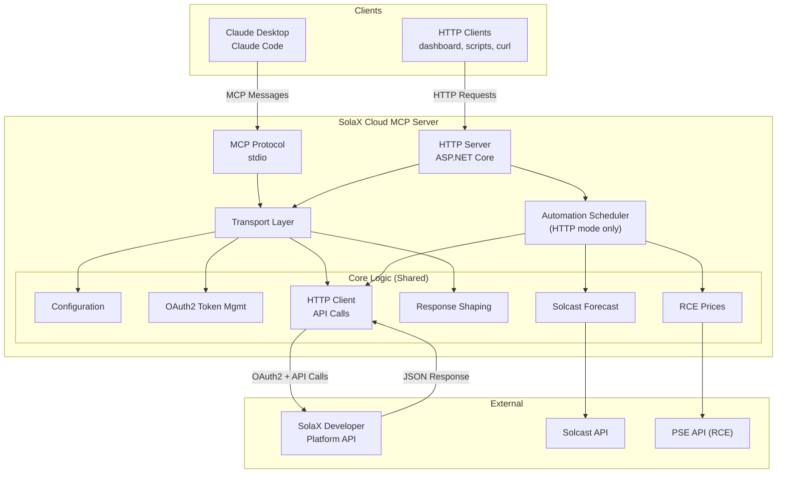

---

## Component Architecture

### Component Diagram

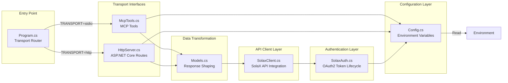

### File Structure

```
src/SolaxCloudMcp/
├── Program.cs              # Entry point: routes to MCP or HTTP based on TRANSPORT env var
├── Config.cs               # Environment variable loading & validation
├── SolaxAuth.cs            # OAuth2 token lifecycle (fetch, cache, refresh, invalidate)
├── SolaxClient.cs          # SolaX API HTTP client (realtime data, battery control, rate limiting)
├── Models.cs               # Response shaping (normalize, decode status codes, group fields)
├── SolaxService.cs         # Business logic shared by the MCP tools and the HTTP routes
├── McpTools.cs             # MCP tools and the stdio server
├── HttpServer.cs           # ASP.NET Core HTTP server, routes, scheduler start/stop
├── Automation.cs           # Tariff windows, settings, charge planner, export planner (pure functions)
├── AutomationScheduler.cs  # Background loops: run the planners, write to the inverter
├── Forecast.cs             # Solcast forecast (multi-site sum, cache, optional cache file)
├── Prices.cs               # RCE prices from the PSE API (15-min slots, 30-min cache)
├── Consumption.cs          # CLI: hourly consumption profiles from SolaX history
├── Util.cs                 # JSON, rounding and local-time helpers
└── Components/             # Dashboard page served at /dashboard (Blazor Server + Syncfusion Blazor)
```

---

## Authentication Flow

### OAuth2 Token Lifecycle

The server uses **client credentials** OAuth2 flow to obtain access tokens from SolaX.

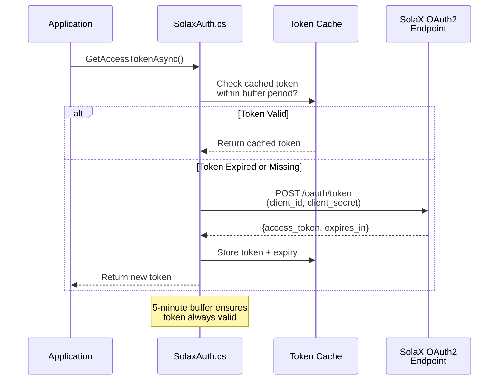

**Key Features:**

- **Token Caching**: Tokens are cached in memory and reused until expiry
- **Expiry Buffer**: 300-second (5-minute) buffer prevents edge-case token expiry during requests
- **Thread-Safe**: a `SemaphoreSlim` ensures only one caller refreshes the token at a time
- **Automatic Retry**: On 10402 (auth failure), the client automatically invalidates the cached token and retries once

### Credentials

Credentials are loaded from environment variables at startup:

```
SOLAX_CLIENT_ID      # OAuth2 Client ID (required)
SOLAX_CLIENT_SECRET  # OAuth2 Client Secret (required)
SOLAX_DEVICE_SN      # Device serial number (optional, used as default)
```

---

## Data Flow

### Query Flow: Get Real-Time Data

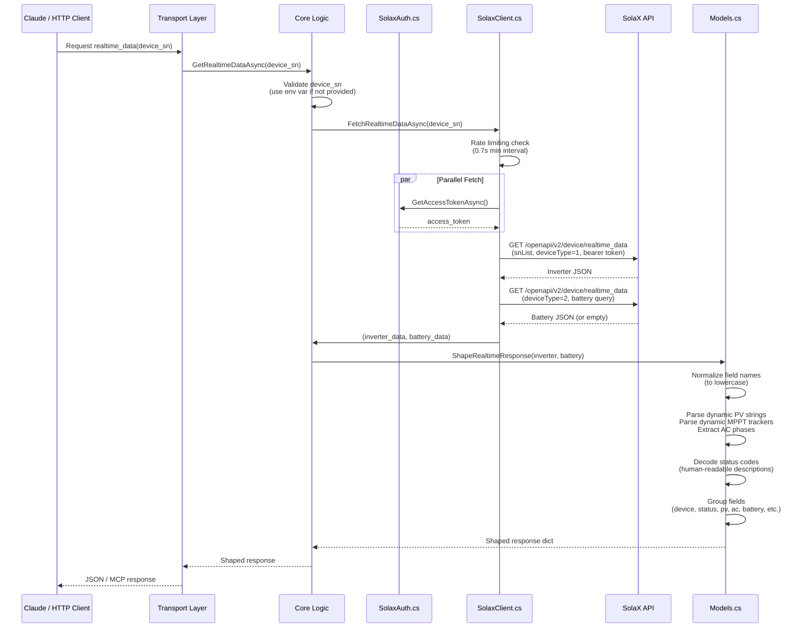

### Control Flow: Set Battery Mode

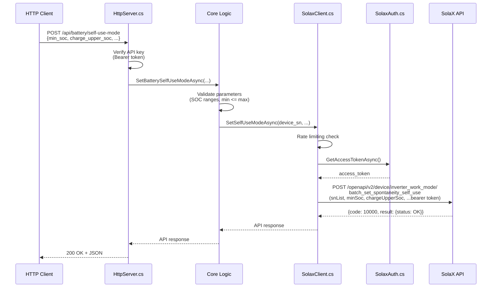

---

## Rate Limiting

The server implements **soft rate limiting** to respect SolaX API quotas.

### Rate Limit Strategy

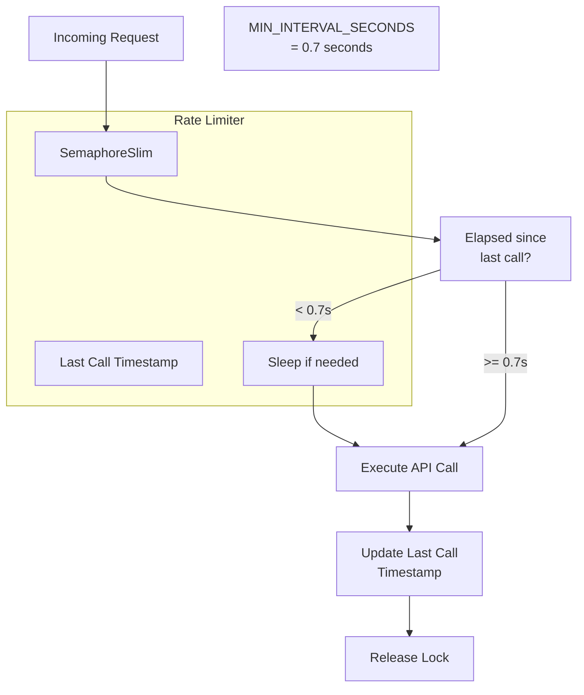

**Configuration:**

- **Minimum Interval**: 0.7 seconds between API calls
- **Justification**: SolaX allows 100 calls/minute; 0.7s = 85-86 calls/minute (conservative buffer)
- **Enforcement**: one `SemaphoreSlim` per client ensures thread-safe enforcement
- **Coverage**: Applied to both `FetchRealtimeDataAsync()` and `SetSelfUseModeAsync()`

**Behavior:**

```
# If you make 3 requests immediately:
# Request 1: 0ms elapsed → execute immediately
# Request 2: happens at +0ms → sleep 0.7s, then execute at +0.7s
# Request 3: happens at +0.7ms → sleep 0.7s, then execute at +1.4s
```

---

## Response Shaping

The raw SolaX API response is complex and inconsistent. The response shaper transforms it into a clean, human-friendly structure.

### Normalization Pipeline

```mermaid
graph LR
    Raw["Raw API Response<br/>(mixed casing,<br/>flat structure)"]
    
    Normalize["1. Normalize<br/>Keys to lowercase"]
    DynPV["2. Parse Dynamic<br/>PV Strings<br/>(pv1voltage,<br/>pv2voltage, ...)"]
    DynMPPT["3. Parse Dynamic<br/>MPPT Trackers<br/>(mppt1voltage, ...)"]
    ExtractPhases["4. Extract AC Phases<br/>(3-phase fixed)"]
    DecodeStatus["5. Decode Status Codes<br/>(to human-readable)"]
    GroupFields["6. Group Fields<br/>(device, pv, ac,<br/>battery, etc.)"]
    
    Shaped["Shaped Response<br/>(clean, grouped,<br/>decoded)"]
    
    Raw --> Normalize
    Normalize --> DynPV
    DynPV --> DynMPPT
    DynMPPT --> ExtractPhases
    ExtractPhases --> DecodeStatus
    DecodeStatus --> GroupFields
    GroupFields --> Shaped
```

### Example Transformation

**Raw Response (from API):**
```json
{
  "deviceSn": "X3ABCD0123",
  "deviceStatus": 102,
  "pv1voltage": 421.7,
  "pv1current": 5.2,
  "pv1power": 2189.0,
  "pv2voltage": 418.0,
  "pv2current": 4.8,
  "pv2power": 2006.4,
  "acvoltage1": 224.1,
  "accurrent1": 18.2,
  "acpower1": 4078.0,
  ...
}
```

**Shaped Response:**
```json
{
  "device": {
    "deviceSn": "X3ABCD0123",
    "registerNo": "SE123456SP",
    ...
  },
  "status": {
    "code": 102,
    "description": "Normal"
  },
  "pv": [
    {"string": 1, "voltage_V": 421.7, "current_A": 5.2, "power_W": 2189.0},
    {"string": 2, "voltage_V": 418.0, "current_A": 4.8, "power_W": 2006.4}
  ],
  "ac": {
    "phases": [
      {"phase": 1, "voltage_V": 224.1, "current_A": 18.2, "power_W": 4078.0, ...}
    ],
    ...
  },
  ...
}
```

### Key Transformations

1. **Field Case Normalization**: Convert all keys to lowercase for consistent access
2. **Dynamic Parsing**: PV strings and MPPT trackers are variable-count; parser extracts indices and builds arrays
3. **Status Decoding**: Integer status codes (e.g., 102) are mapped to human-readable descriptions (e.g., "Normal")
4. **Logical Grouping**: Related fields are grouped into logical sections (device, pv, ac, battery, etc.)
5. **Unit Notation**: Field names include units (e.g., `voltage_V`, `power_W`) for clarity

---

## Error Handling

### Error Hierarchy

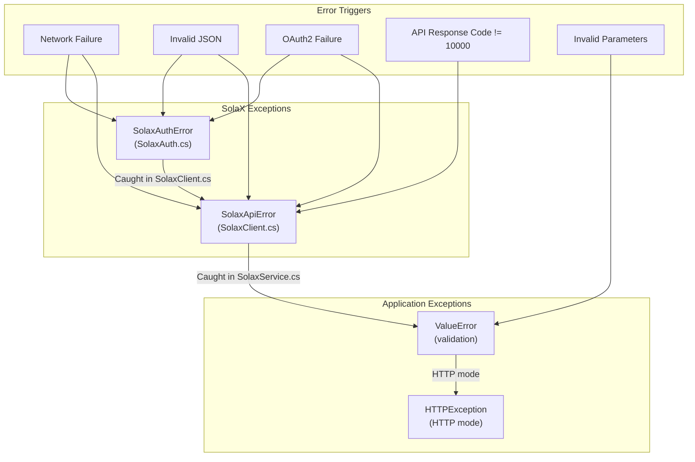

### Automatic Retry Logic

When the API returns **10402 (access_token authentication failed)**:

1. The cached token is invalidated
2. A fresh token is requested
3. The API call is retried once

```csharp
var responseBody = await Once("");
if (J.Num(responseBody["code"]) == 10402)
{
    _auth.InvalidateToken();               // Clear cache
    responseBody = await Once("Retry: ");  // Fetch a new token and send the request again
}
```

This handles cases where tokens expire between fetch and use, or credentials are briefly invalid.

### HTTP Error Responses

| Status Code | Scenario | Response |
|---|---|---|
| 200 | Success | `{...data...}` or `{code: 10000, result: {...}}` |
| 400 | Bad request (missing device_sn, min_soc above charge_upper_soc) | `{detail: "error message"}` |
| 422 | A body or query field is missing or out of range | `{detail: "field: rule"}` |
| 403 | Authentication failure (invalid/missing API key) | `{detail: "Invalid API key"}` |
| 502 | The SolaX, Solcast or PSE API failed (details only in the logs) | `{detail: "SolaX API request failed"}` |
| 503 | The feature is not enabled (Solcast, automation, export) | `{detail: "..."}` |
| 500 | Unhandled server error | `{detail: "Internal Server Error"}` |

---

## Battery Automation (HTTP server only)

`Automation.cs` holds the planners as pure functions and one `AutomationScheduler` (`AutomationScheduler.cs`). `HttpServer.cs` starts the scheduler when `AUTOMATION_ENABLED=1` and stops it on shutdown. MCP mode never starts it.

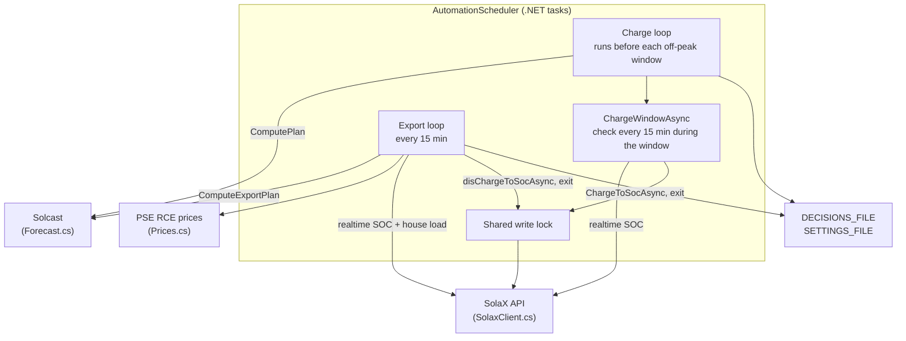

### Charge planner

1. `NextTrigger` finds the next off-peak window start (`Tariff.WindowsFor`: G12w winter and summer hours, weekends and Polish public holidays) and runs `AUTOMATION_LEAD_MINUTES` before it.
2. `ComputePlan` takes the peak hours after the window, sums consumption minus the PV forecast hour by hour, and turns the largest cumulative deficit into `targetSoc`.
3. `ChargeWindowAsync` runs from window start to window end. Every 15 minutes, if SOC is below the target, it sends `soc_target_control_mode` with a positive (charge) power of `AUTOMATION_CHARGE_POWER_KW`. The inverter stops by itself at the target. At the window end, and on errors or shutdown, it sends `exit_vpp_mode`.

The X3-NEO-LV ignores the Self Use grid-charge settings, so the planner uses remote control, not `batch_set_spontaneity_self_use`.

### Export planner

1. Every 15 minutes `ComputeExportPlan` computes the surplus: energy above `AUTOMATION_MIN_SOC` minus the house need until the next off-peak window.
2. It assigns the surplus to the most expensive 15-minute RCE slots whose net price is at or above `EXPORT_MIN_PRICE_PLN_KWH`.
3. `ApplyExportAsync` sends `soc_target_control_mode` with a negative (discharge) power in an export slot. The setpoint is the planned export plus the live house load (`LiveHouseLoadKw`), capped at `EXPORT_MAX_POWER_KW`. The target SOC is `recommendedExportFloorSoc`. Outside export slots it exits remote control.

### Safety rules

- Both planners are dry run by default (`AUTOMATION_DRY_RUN`, `EXPORT_DRY_RUN`).
- One `SemaphoreSlim` serialises every inverter write. The export loop does nothing while a charge window is active.
- Export: after a failed command or planner error, outside export slots, and on server stop, the scheduler sends `exit_vpp_mode`. After a restart the remote control state is unknown, so the first export run exits it.
- Charge: a failed command is retried at the next 15-minute check. The exit is sent at the window end, also after errors and on server stop.
- `soc_target_control_mode` has no duration. If the server dies mid-command, the inverter still stops at the target SOC.
- The dashboard switch (`POST /api/export/active`) turns the export loop off and exits remote control at once. It is saved to `SETTINGS_FILE`.
- Every decision is logged and kept in memory (last 200), and in `DECISIONS_FILE` when it is set.

---

## Deployment Architecture

### Dual-Transport Architecture

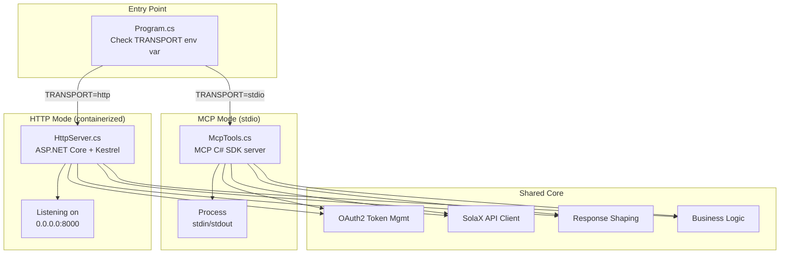

### Container Deployment

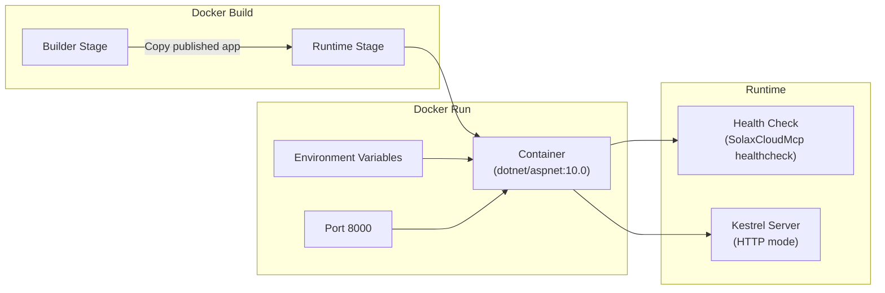

**Multi-stage Build Benefits:**

- Build stage: .NET SDK image, runs `dotnet publish` (large)
- Runtime stage: ASP.NET Core runtime image plus the published app (small)
- The images are multi-arch (x64 and ARM64)

---

## Key Design Patterns

### 1. Shared Service Pattern

Both MCP and HTTP modes call the same methods of **`SolaxService`**:

```csharp
// Shared logic (SolaxService.cs)
public virtual async Task<JsonObject> GetRealtimeDataAsync(string? deviceSn = null) { ... }

// MCP tool (McpTools.cs)
public Task<JsonObject> GetRealtimeData(string? device_sn = null) => Call(service.GetRealtimeDataAsync(device_sn));

// HTTP route (HttpServer.cs); the API key is checked in middleware, before the body is read
app.MapPost("/api/realtime-data", async (HttpRequest request) =>
    Results.Json(await service.GetRealtimeDataAsync((await Body.ReadAsync(request)).Text("device_sn"))));
```

**Benefit**: Zero code duplication; business logic evolves in one place.

### 2. Shared State with a Lock

`SolaxAuth` keeps one token for the process and guards it with a `SemaphoreSlim`:

```csharp
await _lock.WaitAsync();
try
{
    if (_token is not null && Environment.TickCount64 < _expiresAtMs - ExpiryBufferMs) return _token;
    // Otherwise fetch a new token
}
finally { _lock.Release(); }
```

**Benefit**: Minimal overhead; single token shared across all concurrent requests.

### 3. Transport-Agnostic Configuration

Configuration is read from environment variables (`Config.cs`), not hardcoded. An empty value counts as not set:

```csharp
Config.ClientId();                 // SOLAX_CLIENT_ID, throws when missing
Config.DefaultDeviceSn();          // SOLAX_DEVICE_SN, may be null
Config.Env("TRANSPORT", "stdio");  // stdio or http
```

**Benefit**: Same codebase works in Docker, local development, and cloud environments.

### 4. Soft Rate Limiting

Rate limiting is soft — enforced per process (`SolaxClient.MinInterval`, 0.7 s), not globally.

**Benefit**: Simple, predictable, no distributed cache required.

### 5. JSON Nodes for Payloads

API payloads, plans and decisions are `JsonObject` values with literal keys (they mix camelCase and snake_case, as the dashboard and the state files expect). Settings and domain values (`Settings`, `Tariff`, `Trigger`, `PriceSlot`) are typed records.

**Benefit**: The HTTP responses and the state files (`decisions.jsonl`, `settings.json`, Solcast cache) keep the exact format of the earlier Python server. `GoldenTests.cs` compares the planners with results recorded from that server.

### 6. Wall-Clock Time Arithmetic

The planners add hours on the local wall clock (`LocalTime.AddWall`), as the Python server did. `J.Round` rounds like Python `round()`. So plans are the same also on DST change days.

---

## Data Consistency & Integrity

### API Call Resilience

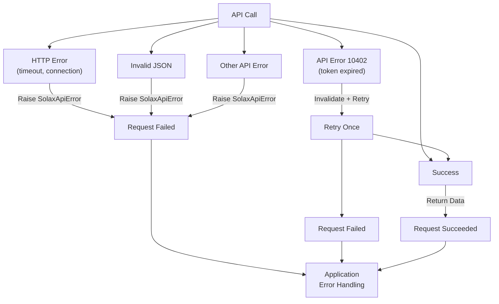

### Battery Data Graceful Degradation

If battery data is unavailable (battery-less system, offline, etc.):

```csharp
public async Task<JsonObject?> FetchBatteryDataAsync(string deviceSn)
{
    try { return await RequestRealtimeAsync(deviceSn, DeviceTypeBattery, RequestSnTypeInverter); }
    catch (SolaxApiException) { return null; }  // No battery on this system
}
```

The response shaper handles `null`: `Models.ShapeRealtimeResponse(inverter, battery: null)`.

Result: `"battery": null` in shaped response (not an error).

---

## Performance Considerations

### Token Caching Impact

- **Without caching**: Every request would require an OAuth2 round-trip (~200ms)
- **With caching**: First request ~200ms, subsequent requests ~0ms (until expiry)
- **Result**: ~100x speedup for typical polling scenarios

### Rate Limiting Impact

- Enforces 0.7s minimum interval between calls
- For 100 calls/minute, roughly 1 call per 0.6 seconds → no breaches with buffer
- Prevents thundering herd and API throttling

### Response Shaping Impact

- Parsing & normalization: ~5-20ms per response
- Acceptable for typical 30-60 second poll intervals
- Only shapes data that will be consumed (lazy where possible)

### Memory Footprint

- Token cache: ~100 bytes per token
- Rate limiter state: ~16 bytes
- Per-request overhead: minimal (async I/O)
- The production container has 512 MB RAM

---

## Testing Strategy

### Unit Tests

Run with `dotnet test` (189 tests). External APIs are replaced with a fake HTTP handler or fakes; nothing reaches the inverter.

- `GoldenTests.cs`: the planners, tariff zones, forecast and realtime shaping, PSE parsing and consumption profiles give the same results as the earlier Python server (`golden/*.json`), including DST change days
- `ModelsTests.cs`: Response shaping, status decoding, dynamic parsing
- `SmallTests.cs`: Environment variables, token cache, token retry on 10402, remote control commands, PSE RCE parsing (period end times, DST), consumption profiles
- `ForecastTests.cs`: Solcast parsing, multi-site sum, cache, stale data, cache file format
- `AutomationTests.cs`: Tariff windows and holidays, charge and export plans, scheduler safety rules, export switch, decision history
- `HttpServerTests.cs`: Auth, routes, validation, error mapping, export test/stop, dashboard settings, MCP tool list, exit of remote control on server stop

### Integration Tests

- HTTP server test: `curl http://localhost:8000/health`
- Docker test: `docker-compose up -d && curl http://localhost:8000/health`

### Test Coverage

- Edge cases: battery-less devices, null status codes, missing fields
- Error handling: network failures, auth failures, API errors
- Rate limiting: concurrent requests, interval enforcement
- Response shaping: PV string parsing, MPPT parsing, status decoding

---

## Conclusion

The SolaX Cloud MCP server is designed as a **lean, transport-agnostic bridge** between the complex SolaX API and clean consumer interfaces (MCP, HTTP). Key strengths:

- **Shared logic**: Business logic written once, used by both MCP and HTTP
- **Automatic resilience**: Token refresh, retries on auth failure
- **Clean responses**: Complex raw data transformed into intuitive structure
- **Soft rate limiting**: Respects API quotas without external coordination
- **Safe automation**: Dry run by default, one write lock, exit remote control on every error and on stop

The architecture prioritizes simplicity over sophistication — avoiding premature abstraction, caching only what's necessary, and failing fast with clear error messages.
